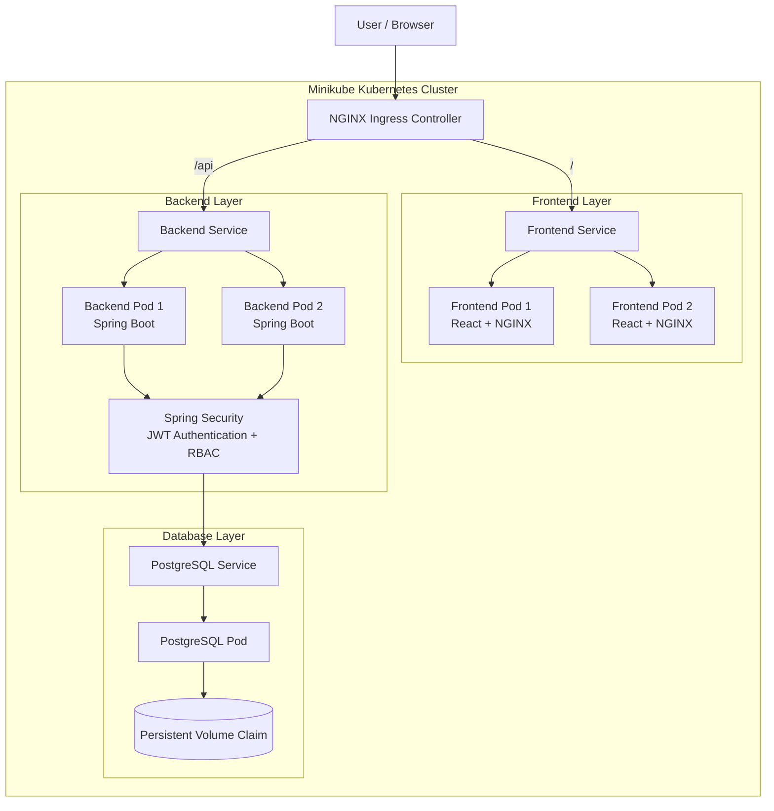
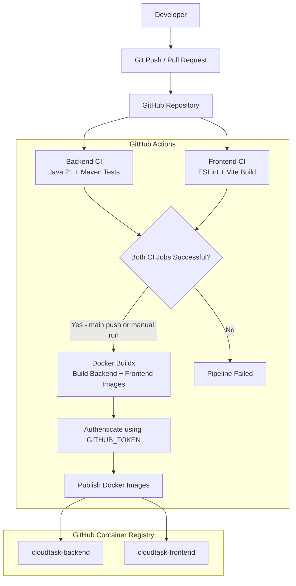

# CloudTask

**An enterprise-style task management platform built with Java, Spring Boot, React, PostgreSQL, Docker, and Kubernetes.**

CloudTask is a full-stack task management application designed to demonstrate modern backend engineering, secure authentication, REST API development, database management, containerization, Kubernetes orchestration, and CI/CD automation.

The project is developed incrementally, with an emphasis on clean architecture, security, scalability, maintainability, and production-oriented engineering practices.

---

## Table of Contents

- [Architecture](#architecture)
- [Technology Stack](#technology-stack)
- [Features](#features)
- [Project Structure](#project-structure)
- [Getting Started](#getting-started)
- [Running with Docker Compose](#running-with-docker-compose)
- [Kubernetes Deployment](#kubernetes-deployment)
- [API Endpoints](#api-endpoints)
- [Testing](#testing)
- [CI/CD Pipeline](#cicd-pipeline)
- [Current Project Status](#current-project-status)
- [Future Enhancements](#future-enhancements)

---

## Architecture

CloudTask follows a layered full-stack architecture. The React frontend communicates with Spring Boot REST APIs, while Spring Security handles JWT authentication and role-based authorization. PostgreSQL provides persistent storage.

### 1. Application Architecture

The following diagram represents the current Kubernetes deployment running locally on Minikube.



**Request flow:**

1. The user accesses CloudTask through the browser.
2. The NGINX Ingress Controller receives incoming requests.
3. Requests to `/` are routed to the frontend service.
4. Requests to `/api` are routed to the backend service.
5. The frontend communicates with the Spring Boot REST APIs.
6. Spring Security validates JWT tokens and enforces role-based access.
7. The backend interacts with PostgreSQL for persistent data storage.
8. Kubernetes services provide stable internal networking between application components.

The Kubernetes deployment currently uses two frontend replicas and two backend replicas, with PostgreSQL backed by a Persistent Volume Claim.

### 2. CI/CD Architecture

CloudTask uses GitHub Actions to automate backend testing, frontend validation, and Docker image publishing.



**Pipeline stages:**

1. Developer pushes code or opens a pull request.
2. GitHub Actions checks out the repository.
3. Backend tests execute using Java 21 and Maven.
4. Frontend linting and production build execute using Node.js.
5. When the required jobs succeed on a main-branch push (or a manual run on main), Docker images are built.
6. Images are published to GitHub Container Registry (GHCR).

**Note:** The current pipeline publishes Docker images. Automated deployment to Kubernetes is not yet configured.

### 3. Deployment Environments

| Environment | Components | Access |
|---|---|---|
| Local development | Spring Boot, React, PostgreSQL | `localhost` |
| Docker Compose | Backend, frontend, PostgreSQL | `http://localhost:3000` |
| Kubernetes | Frontend, backend, PostgreSQL, Ingress | `http://cloudtask.local` |
| Container registry | Backend and frontend images | GitHub Container Registry |

---

## Technology Stack

### Backend
- Java 21
- Spring Boot 4
- Spring Security
- Spring Data JPA
- Hibernate
- JWT Authentication
- Maven
- PostgreSQL

### Frontend
- React
- JavaScript
- Vite
- HTML5
- CSS3
- NGINX

### Database
- PostgreSQL 17
- Spring Data JPA
- Hibernate ORM
- Flyway database migrations

### DevOps and Infrastructure
- Docker
- Docker Compose
- Kubernetes
- Minikube
- Kubernetes Services and Deployments
- ConfigMaps and Secrets
- Persistent Volumes and Persistent Volume Claims
- NGINX Ingress Controller
- GitHub Actions
- GitHub Container Registry (GHCR)

### Development and Testing Tools
- Visual Studio Code
- Git and GitHub
- Postman
- Maven
- ESLint

---

## Features

### Authentication and Security
- User registration and login.
- JWT-based authentication.
- Access and refresh token management.
- Refresh token validation and revocation.
- Secure logout.
- Spring Security integration.
- Role-Based Access Control (RBAC).
- Protected REST endpoints.
- Centralized exception handling.

### Task Management
- Create and retrieve tasks.
- Update task status.
- Task filtering by status and priority.
- Filter tasks by assignee.
- Pagination and sorting.
- Task ownership and assignment.
- Role-aware task access.

### Backend Engineering
- Layered architecture using controllers, services, and repositories.
- RESTful API design.
- Spring Data JPA and Hibernate.
- PostgreSQL persistence.
- Flyway database migrations.
- Input validation.
- Centralized error handling.
- Unit and integration testing.

### Frontend
- React-based user interface.
- Login and registration.
- Authenticated task dashboard.
- Create and view tasks.
- Update task status.
- Filter and paginate tasks.
- Automatic access-token refresh.
- Logout and session handling.

### Infrastructure and DevOps
- Dockerized backend and frontend.
- Separate Docker Compose application stack.
- Kubernetes deployments and services.
- Two backend replicas and two frontend replicas.
- Kubernetes health and readiness probes.
- Persistent PostgreSQL storage in Kubernetes.
- NGINX Ingress routing.
- GitHub Actions CI/CD workflow.
- Docker image publishing to GHCR.

---

## Project Structure

```text
cloudtask/
│
├── backend/
│   └── cloudtask-api/
│       ├── src/
│       │   ├── main/
│       │   │   ├── java/com/cloudtask/api/
│       │   │   └── resources/
│       │   └── test/
│       ├── Dockerfile
│       ├── .dockerignore
│       ├── pom.xml
│       └── mvnw
│
├── frontend/
│   ├── src/
│   ├── public/
│   ├── Dockerfile
│   ├── nginx.conf
│   ├── .dockerignore
│   ├── package.json
│   └── vite.config.js
│
├── database/
│
├── docker/
│
├── docs/
│
├── k8s/
│   └── base/
│       ├── configmap.yaml
│       ├── postgres.yaml
│       ├── backend.yaml
│       ├── backend-alias.yaml
│       ├── frontend.yaml
│       └── ingress.yaml
│
├── postman/
│
├── .github/
│   └── workflows/
│       └── ci-cd.yml
│
├── .gitignore
├── docker-compose.yml
├── docker-compose.app.yml
└── README.md
```

**Security note:** Environment files and Kubernetes secrets containing credentials are excluded from Git. Do not commit `.env` or `k8s/base/secrets.yaml`.

---

## Getting Started

### Prerequisites

Install the following tools:

- Java 21
- Node.js and npm
- Maven (the project includes Maven Wrapper)
- PostgreSQL 17
- Docker Desktop
- Git
- Postman (optional)

For Kubernetes deployment, also install:

- Minikube
- kubectl

### Clone the Repository

```bash
git clone <YOUR_GITHUB_REPOSITORY_URL>
cd cloudtask
```

### Backend Setup

Navigate to the backend:

```bash
cd backend/cloudtask-api
```

Run the application:

```bash
./mvnw spring-boot:run
```

The backend runs on:

```text
http://localhost:8080
```

The health endpoint is:

```text
http://localhost:8080/actuator/health
```

Configure the required database connection and JWT environment variables before starting the application. Refer to the project's environment configuration; do not commit credentials.

### Frontend Setup

Open a separate terminal:

```bash
cd frontend
npm install
npm run dev
```

The Vite development server runs on the local port displayed by Vite.

---

## Running with Docker Compose

CloudTask provides a separate application Compose file so it can run alongside other Docker projects without taking over their containers.

Build the backend image from the backend directory:

```bash
cd backend/cloudtask-api
docker build -t cloudtask-api:1.1 .
```

Build the frontend image:

```bash
cd ../../frontend
docker build -t cloudtask-frontend:1.0 .
```

Return to the project root:

```bash
cd ..
```

Make sure the required environment variables are configured in the root `.env` file.

Start the application stack:

```bash
docker compose -f docker-compose.app.yml up -d
```

Check container status:

```bash
docker compose -f docker-compose.app.yml ps
```

Access CloudTask:

```text
http://localhost:3000
```

View application logs:

```bash
docker compose -f docker-compose.app.yml logs -f
```

Restart the application containers:

```bash
docker compose -f docker-compose.app.yml restart
```

The Compose application stack uses the existing PostgreSQL Docker network and database. It is kept separate from the Kubernetes database.

---

## Kubernetes Deployment

CloudTask has been deployed locally to Kubernetes using Minikube.

### Start Minikube

```bash
minikube start --driver=docker
```

### Create Namespace

```bash
kubectl create namespace cloudtask
```

### Apply Configuration

Create the Kubernetes Secret locally from your environment variables, then apply the configuration and application resources:

```bash
kubectl apply -f k8s/base/configmap.yaml
kubectl apply -f k8s/base/secrets.yaml
kubectl apply -f k8s/base/postgres.yaml
kubectl apply -f k8s/base/backend.yaml
kubectl apply -f k8s/base/backend-alias.yaml
kubectl apply -f k8s/base/frontend.yaml
kubectl apply -f k8s/base/ingress.yaml
```

**Important:** `k8s/base/secrets.yaml` is generated locally and is intentionally excluded from Git. Do not publish it.

### Verify Deployment

```bash
kubectl get pods -n cloudtask
kubectl get services -n cloudtask
kubectl get deployments -n cloudtask
kubectl get ingress -n cloudtask
```

### Access the Application

The Minikube NGINX Ingress Controller is configured to route traffic using:

```text
http://cloudtask.local
```

The local hosts file should contain:

```text
127.0.0.1 cloudtask.local
```

The Minikube tunnel must be running for the configured local ingress access.

---

## API Endpoints

### Authentication

| Method | Endpoint | Description |
|---|---|---|
| POST | `/api/auth/register` | Register a new user |
| POST | `/api/auth/login` | Authenticate user |
| POST | `/api/auth/refresh` | Refresh access token |
| POST | `/api/auth/logout` | Revoke refresh token |

### Task Management

| Method | Endpoint | Description |
|---|---|---|
| POST | `/api/tasks` | Create a task |
| GET | `/api/tasks` | Retrieve tasks |
| PATCH | `/api/tasks/{taskId}/status` | Update task status |

The task listing endpoint supports filtering, pagination, and sorting.

Example:

```text
GET /api/tasks?page=0&size=10&sortBy=createdAt&sortDirection=DESC
```

Optional filters include:

- `status`
- `priority`
- `assigneeId`

### Role-Based Access

The application supports three roles:

- `ADMIN`
- `MANAGER`
- `USER`

Access to tasks and administrative endpoints is controlled by the authenticated user's role and task ownership or assignment.

---

## Testing

The backend includes unit and integration tests covering core application functionality.

Run the backend test suite:

```bash
cd backend/cloudtask-api
./mvnw test
```

The latest verified backend test run completed with:

**56 tests passed — 0 failures, 0 errors, 0 skipped.**

Frontend validation:

```bash
cd frontend
npm run lint
npm run build
```

API testing can also be performed using the Postman collection in the `postman/` directory.

---

## CI/CD Pipeline

The GitHub Actions workflow is located at:

```text
.github/workflows/ci-cd.yml
```

The pipeline currently performs:

1. Backend Maven tests.
2. Frontend ESLint validation.
3. Frontend production build.
4. Docker image build using Docker Buildx.
5. Publishing backend and frontend images to GitHub Container Registry.

Published image naming:

```text
ghcr.io/<github-owner>/<repository>-backend:latest
ghcr.io/<github-owner>/<repository>-frontend:latest
```

The workflow uses GitHub Actions permissions and `GITHUB_TOKEN` for registry authentication.

---

## Current Project Status

| Phase | Description | Status |
|---|---|---|
| Backend development | Spring Boot REST APIs, authentication, RBAC, task management | Complete |
| Backend testing | Unit and integration tests | Complete |
| React frontend | Login, registration, task dashboard, filters | Complete |
| Dockerization | Backend and frontend Docker images | Complete |
| Docker Compose | Application containers and health checks | Complete |
| Kubernetes | Deployments, services, configuration, persistent database | Complete |
| Ingress | NGINX Ingress routing | Complete |
| GitHub Actions | CI tests, frontend build, Docker image publishing | Complete |
| Automated deployment | Deploy published images to Kubernetes | Planned |

---

## Future Enhancements

Potential next improvements include:

- Automated Kubernetes deployment from GitHub Actions.
- Cloud deployment to a suitable hosting platform.
- Helm-based application packaging and configuration.
- Horizontal Pod Autoscaling.
- Centralized logging and monitoring.
- Metrics and observability using Prometheus and Grafana.
- Kafka-based asynchronous task notifications.
- Additional integration and end-to-end tests.

---

## Project Goal

CloudTask is a practical portfolio project demonstrating full-stack application development and modern backend engineering practices, including secure API development, relational database persistence, containerization, Kubernetes orchestration, and CI/CD automation.
